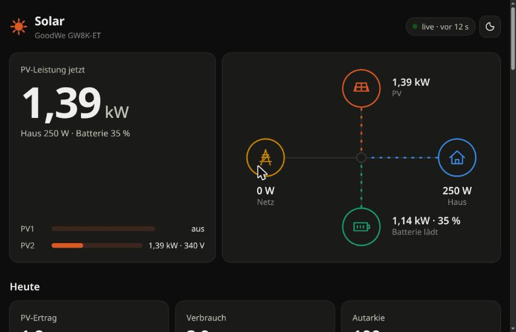
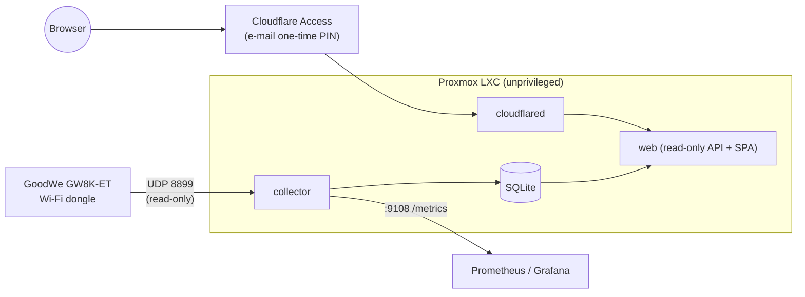
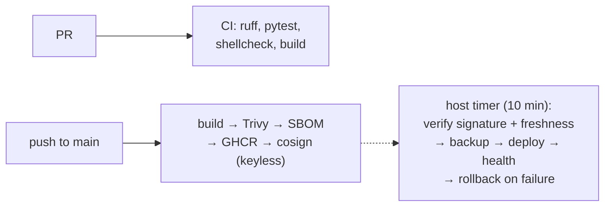

# solar

A local-first dashboard for a **GoodWe hybrid inverter** (PV + battery + smart meter).
It reads the inverter directly over the LAN every 2 seconds — no vendor cloud, no
SEMS app — stores the data in SQLite, and serves a fast, private web dashboard.



## What it does

- **Reads ~150 values** from the inverter via GoodWe's local UDP protocol (port 8899),
  using the [`goodwe`](https://github.com/marcelblijleven/goodwe) library — PV strings,
  three grid phases, house load, battery SoC/SoH/power, smart-meter import/export and
  all lifetime counters. Strictly read-only: no setting is ever written.
- **Live every 2 s** (configurable down to 1 s — the Wi-Fi dongle handled that without a
  single dropped frame in testing), streamed to the browser via server-sent events,
  including a live table of all raw values with names and units.
- **Stores three tiers**: raw 10 s samples (30 days), 5-minute averages and daily
  energy (forever). Daily energy is the delta of the inverter's lifetime counters, so
  missed polls never lose energy.
- **Imports the full history** from GoodWe's SEMS portal once (resumable, rate-limited);
  imported data never overwrites locally measured data.
- **Dashboard**: live energy flow (server-sent events), today's yield, self-sufficiency
  and self-consumption, day curves with crosshair tooltips, monthly/yearly history,
  per-string / per-phase / battery details. Dependency-free JavaScript under a strict
  Content-Security-Policy; light and dark mode; works on a phone.
- **Savings in euros** from a configurable tariff: avoided grid purchases plus feed-in
  revenue — per day, month, year and lifetime.
- **Battery balance**: energy stored and taken out, round-trip efficiency per month and
  year, and whether it paid off (discharge × import price − charge × feed-in tariff).
- **Prometheus metrics** for every sensor, so an existing Grafana can use them too.

## Architecture



| Component | Network | Can reach | Reachable from |
|---|---|---|---|
| `collector` | `egress` | inverter (UDP) | Prometheus only (Proxmox firewall) |
| `web` | `edge` (internal) | nothing | `cloudflared` only |
| `cloudflared` | `edge` + `egress` | Cloudflare | — (outbound tunnel) |

All containers run as non-root with a read-only root filesystem, `cap_drop: ALL`,
`no-new-privileges`, and memory/PID limits. `cloudflared` validates the Cloudflare
Access JWT itself, so requests without a valid Access session never reach the app.

## Delivery pipeline



- CI runs only on GitHub-hosted runners (public repo — no self-hosted runner ever
  executes fork code).
- Every third-party action is pinned by commit SHA, base images by digest, Python
  dependencies by hash ([`requirements.lock`](requirements.lock)).
- The host **pulls**; CI holds no credential to it. The deployer
  ([`deploy/solar-deploy.sh`](deploy/solar-deploy.sh)) refuses any image not signed by
  this repository's release workflow on `main`, and any image not built strictly later
  than the one running (replay protection).

## Running it yourself

```bash
# try the dashboard with synthetic data
python -m venv .venv && .venv/bin/pip install -e ".[dev]"
.venv/bin/python tools/demo_db.py demo.db
SOLAR_DB=demo.db SOLAR_WEB_DIR=web .venv/bin/python -m solar web   # http://localhost:8080

# against a real inverter
SOLAR_DB=solar.db SOLAR_INVERTER_HOST=192.168.x.y .venv/bin/python -m solar collect
```

Production setup (LXC, firewall, tunnel, timers, history import):
[`deploy/README.md`](deploy/README.md).

## Configuration

| Variable | Default | |
|---|---|---|
| `SOLAR_INVERTER_HOST` | — | inverter / dongle IP |
| `SOLAR_INVERTER_FAMILY` | auto | e.g. `ET` to skip detection |
| `SOLAR_POLL_INTERVAL` | `2` | live refresh, seconds |
| `SOLAR_STORE_INTERVAL` | `10` | raw history resolution, seconds |
| `SOLAR_PRICE_IMPORT` / `SOLAR_PRICE_EXPORT` | `0` | EUR/kWh for the savings figures (0 hides them) |
| `SOLAR_RAW_RETENTION_DAYS` | `30` | raw sample retention |
| `SOLAR_DB` | `/data/solar.db` | |
| `SOLAR_METRICS_PORT` / `SOLAR_WEB_PORT` | `9108` / `8080` | |
| `TZ` | `Europe/Berlin` | day boundaries for daily energy |

## API

All endpoints are read-only JSON: `/api/live`, `/api/stream` (SSE), `/api/day?date=`,
`/api/days?from=&to=`, `/api/periods?by=month|year`, `/api/summary`, `/api/details`,
`/healthz`.

## License

MIT
